# Lead delivery: operator walkthrough

A guided agenda for the stakeholder meeting. We walk the screens in demo order and stop at the
questions under each one. The goal is to agree on how an operator should run lead delivery, so we
can decide what to build after the prototype.

- **The lens is the operator.** For each screen, ask: what do they see, what do they decide, and
  what do they do next, without calling an engineer?
- **This is a prototype.** It runs in memory with fake receivers. The flows are real; the data and
  the outside systems are not.
- **We leave with** answers in the [decisions table](#decisions-to-make) and owners for the
  [action items](#notes-and-action-items).

Screenshots are in [meeting-screenshots/](meeting-screenshots/). To run it live instead:
`npm start`, open <http://localhost:4040/workshop.html>, and press **Reset lab demo** first.

## The operator's job in one picture

```
 Caller ──▶ AI receptionist ──▶ Standard lead ──▶ Delivery engine ──▶ Receiver ──▶ Firm's CRM
                                 (one format)     (mapping, retries,   (Zapier or     (not visible
                                                   signing, log)        a webhook)     to us)
                                                         │
                                                         ▼
                                                    Operator acts
                                              only on the exceptions
```

The strongest claim we can make is **Accepted**: the receiver took the lead. Whether it reached the
CRM is not visible to us, and every screen says so. Operators work by exception: most deliveries
need nothing.

What the operator can do without an engineer:

| Problem | Operator action | Where |
|---|---|---|
| Receiver refuses the lead (missing field) | Edit the mapping, then Resend | Delivery Center |
| Receiver is down for a while | Nothing; it retries for about 21 hours | Delivery Center (Retry queue) |
| The Zap was deleted (HTTP 410) | Destination switches off with the reason; reconnect with the firm | Delivery Center, Firm portal |
| 5 leads in a row fail | Destination switches off; fix, then turn it on | Delivery Center |
| New firm needs setting up | Draft, send the secure link, test, go live | Onboarding |

---

## 1. Canvas: one call, every destination (slides 01–03)

| Slide | What it shows | Say this |
|---|---|---|
| 01 | The delivery graph for Firm A: firm, Zapier app, endpoint, receiver | Every firm has the same shape. Only the destination differs. |
| 02 | Firm A's call is accepted by its Zap | The normal case. The operator does nothing. |
| 03 | Firm B's call is refused: HTTP 400, "Phone is required" | The receiver told us exactly why. The question is who acts on it. |

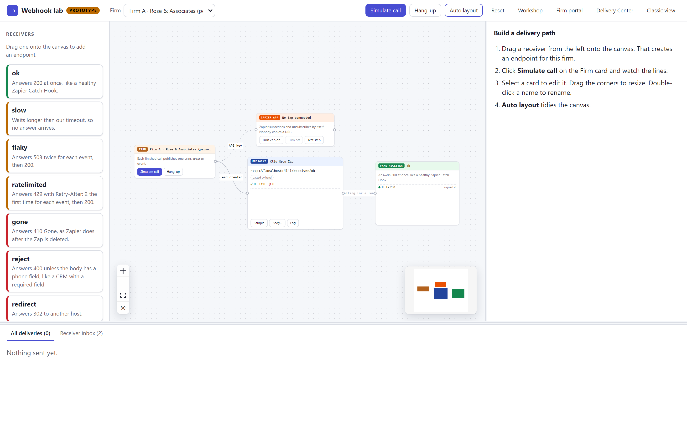
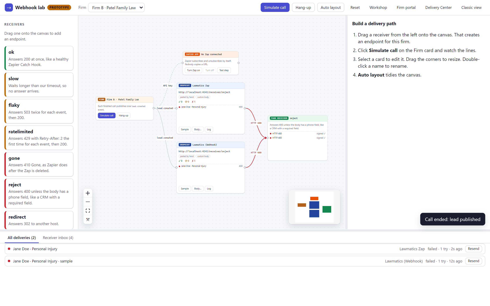

The canvas is an engineering view. Operators will not live here; the Delivery Center is their screen.

**Discuss**

1. Does the operator need this picture at all, or only engineering and support?
2. Firm B has two destinations and both refuse the lead (slide 03). Is that a real pattern (old and
   new CRM running in parallel), or seed data we should clean up?
3. When a lead is refused, who hears about it: the firm, the operator, or both?

## 2. Delivery Center: spot, diagnose, fix, resend (slides 04–07)

This is the operator's daily screen. The story: a lead fails, the operator sees why, fixes it, and
resends it, all without an engineer.

| Slide | Operator step | What to point at |
|---|---|---|
| 04 | **Spot** | KPI tiles. "Needs attention" is the only number that asks for work. |
| 05 | **Diagnose** | The journey (Published → Sent → Accepted → In the CRM?) and the **Next action** box. |
| 06 | **Fix** | Edit mapping: add Phone. No code, no deploy. |
| 07 | **Resend** | Accepted. Same `webhook-id`, so a careful receiver will not create a duplicate. The old row says "Resolved by resend". |

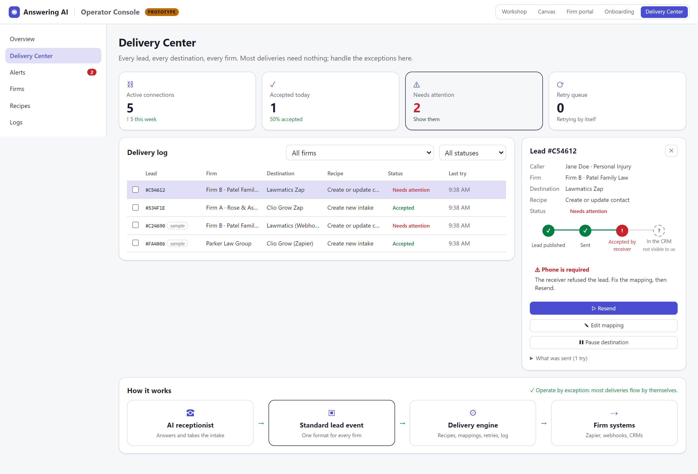
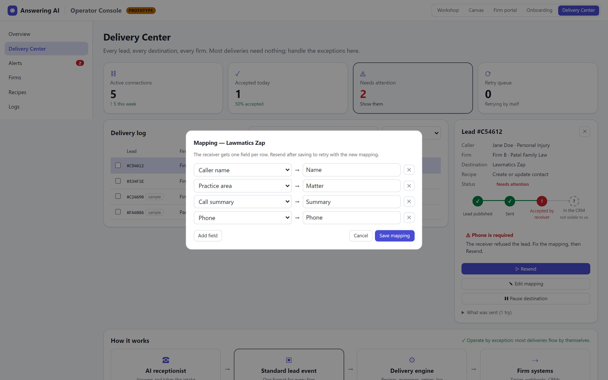
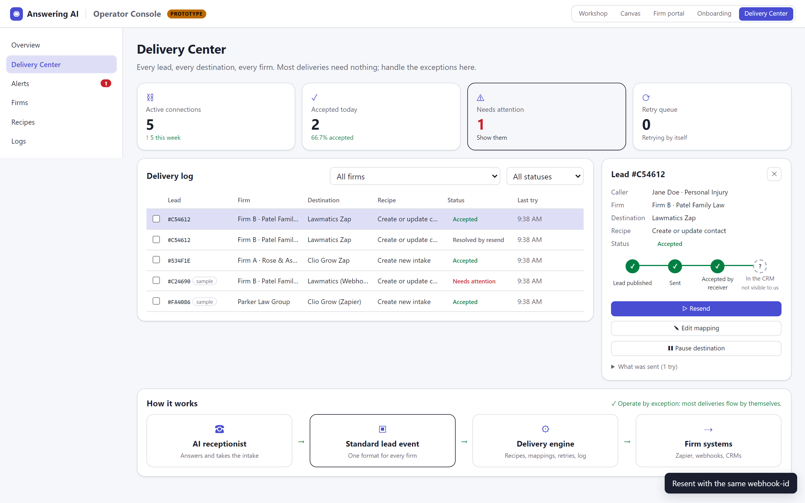

**How an operator should work this screen**

1. Start from **Needs attention**, not from the log.
2. Read the Next action. It is written for the operator, not for an engineer.
3. Fix the cause (mapping, a paused destination, a reconnect), then Resend. Resending without a fix
   gets the same answer.
4. Leave retries alone. "Retrying" means the system is handling it.

**Discuss**

1. Editing a mapping here takes effect at once, and it skips the client approval that onboarding
   requires (section 3). Should a mapping change after go-live need the client's approval again?
2. Who may Resend and Pause: every operator, or a lead role?
3. Should test (sample) leads count in the tiles? Today "Accepted today" leaves them out but the
   acceptance rate counts them, so the two numbers can disagree.
4. What should "Alerts" do: an inbox, email, Slack?

## 3. Assisted onboarding: the operator sets up, the client approves (slides 08–12)

The operator runs the setup with the firm on a call. The firm connects and approves; the system
tests and delivers. One setup record per firm holds everything.

| Slide | State | Operator's next action |
|---|---|---|
| 08 | The queue: every firm by setup state | Work top down; the Next action column says what to do. |
| 09 | Setup record (Chen Family Law, awaiting approval) | Recipe, mapping, secure client link, history. |
| 10 | Client review via the secure link | What the firm sees: what is shared, with a sample. |
| 11 | Client approved | Approval covers this version only. Any change makes a new version. |
| 12 | Ready to go live (Parker Law Group) | Test accepted, client confirmed it in their CRM, so Confirm go-live. |

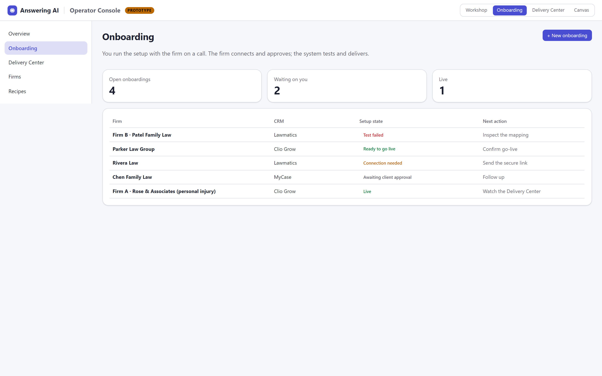
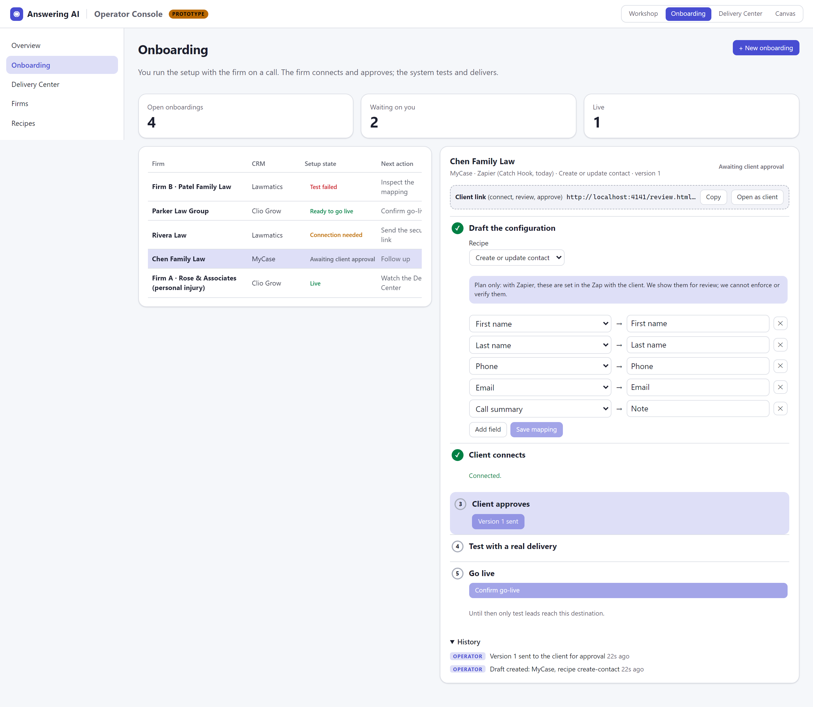
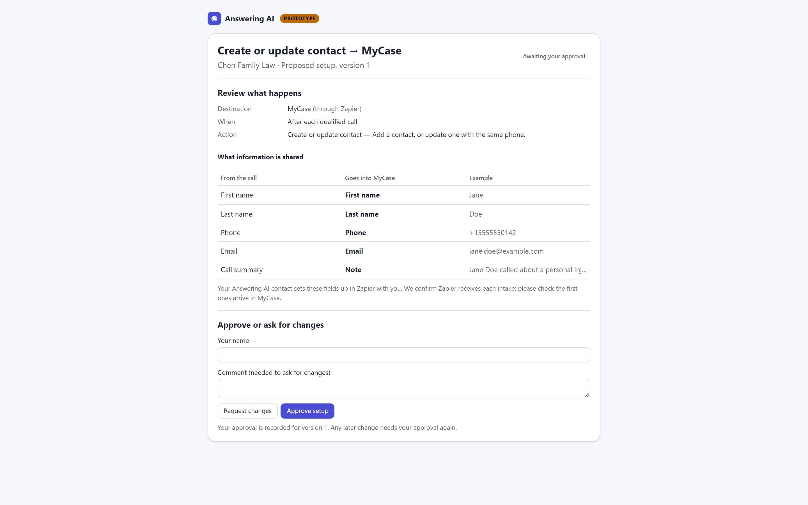
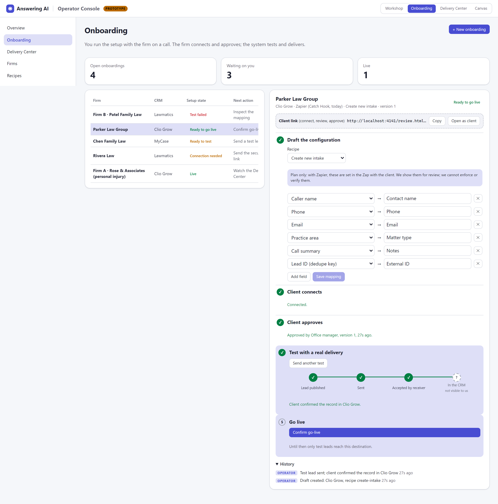

The stages, in order: Draft → Connection needed → Awaiting client approval → Ready to test →
Test accepted → Client confirms → Live. Until go-live, only test leads reach the destination.

With Zapier, the mapping lives in the firm's Zap. We can show the plan and the client can approve it,
but we cannot enforce or check it. With a plain webhook, our mapping is the body we send.

**Discuss**

1. "Client confirms the record is in their CRM" is a click the operator makes during the call. Is
   that enough proof, or do we need the client to confirm themselves?
2. How long should the secure link last, and who can open it?
3. Who owns the queue day to day? What is the target time from "Draft" to "Live"?
4. Can an operator clone a mapping from a similar firm (the prototype supports this), and should
   cloning need review?

## 4. Firm portal: the firm does it alone (slides 13–16)

The same five steps, done by firm staff without an operator: choose destination, connect, choose a
recipe, map fields, send a test.

| Slide | Step |
|---|---|
| 13 | Integrations page with existing connections |
| 14 | Connect Zapier: the firm pastes its API key into the Answering AI app in Zapier. Nothing to copy back. |
| 15 | Choose a recipe |
| 16 | Test accepted. The connection stays "Waiting for first lead" until a real lead is accepted. |

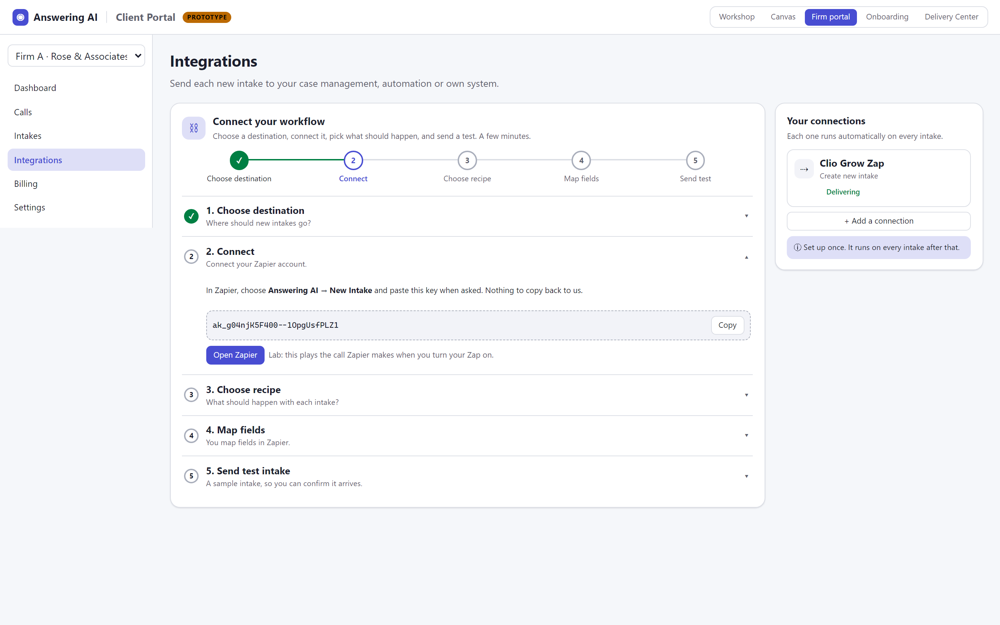
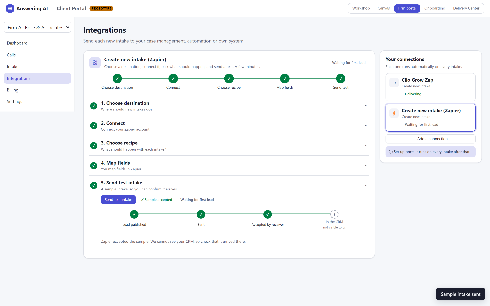

**Where the operator steps in:** a refused test, a connection marked "Needs attention" (for
example after the firm's API key is revoked), or a firm that asks for help. The Legal CRM (direct)
option is marked Planned.

**Discuss**

1. Do we offer self-serve at launch, or start operator-assisted only and open self-serve later?
2. Per-firm API key or sign-in (OAuth) for the Zapier app?
3. When a self-serve setup fails, does the operator see it in the Onboarding queue too?

## Known gaps

The room should hear these before deciding. None of them block the demo.

| Gap | Why it matters |
|---|---|
| No login on operator screens | Anyone on the machine can act. Needed before real use. |
| Everything is in memory | A restart loses all data. The real service needs a database and an outbox. |
| The private-address check has a gap | An IPv4 address written in IPv6 form (for example `[::ffff:127.0.0.1]`) gets past it. Must be fixed before real addresses are allowed. |
| Mapping edits after go-live skip approval | See section 2, question 1. |
| Sidebar items are placeholders | Overview, Alerts, Firms, Recipes and Logs do nothing yet. |
| Tests cover the core rules only | Signing, retries, templates and addresses are tested. Delivery end to end and onboarding are not. |

## Decisions to make

| # | Question | Options | Decision | Owner |
|---|---|---|---|---|
| 1 | Launch with operator-assisted, self-serve, or both? | Assisted first / both | | |
| 2 | Do mapping changes after go-live need client approval? | Yes / No / Only for removed fields | | |
| 3 | Who is alerted when a destination switches off? | Operator / firm / both | | |
| 4 | Zapier app sign-in | Per-firm API key / OAuth | | |
| 5 | Which call types a Zap receives | All / a trigger filter | | |
| 6 | Where the outbox lives | Existing `calls.deliveries` + job queue / separate service | | |
| 7 | How long we keep request and response bodies (they hold caller details) | A number of days, or until resolved | | |
| 8 | Who may Resend and Pause | All operators / lead role | | |
| 9 | Proof that a test reached the CRM | Operator click / client confirms | | |

## Notes and action items

**Notes**

-

**Action items**

| Action | Owner | Due |
|---|---|---|
| | | |
